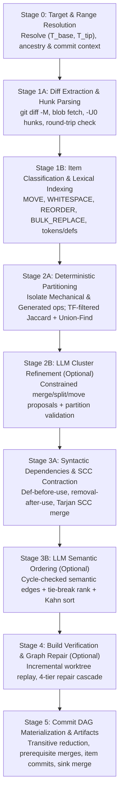
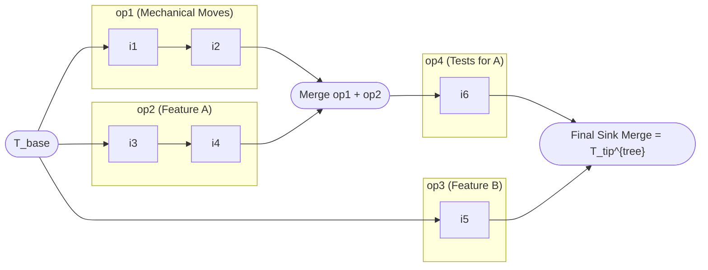

# Commit Decomposition Algorithm Specification

## 1. Overview & Problem Statement

Large or "tangled" Git commits—and multi-commit development branches—frequently mix unrelated concerns: mechanical formatting, file renames, bulk identifier substitutions, preparatory refactorings, core feature logic, configuration updates, generated lockfiles, and tests. Reviewing, bisecting, cherry-picking, or reasoning about such changes as a single monolithic diff is error-prone and expensive.

The **Commit Decomposition Algorithm** transforms the net tree delta between a **base** revision $T_{\text{base}}$ and a **tip** revision $T_{\text{tip}}$ into an ordered **Directed Acyclic Graph (DAG)** of atomic, single-intent **Operations**, materialized back into Git as a structured commit DAG whose final tree is byte-for-byte identical to $T_{\text{tip}}$.

### 1.1 Design Philosophy

1. **Exactness by Construction:** Repository content is modeled as raw byte sequences, and fine-grained edits are represented as non-overlapping zero-context hunks anchored to $T_{\text{base}}$. Any arbitrary subset of change items yields a deterministic, conflict-free file tree without fuzzy patch application.
2. **Deterministic Core, Optional Semantic Layer:** Every stage has a complete deterministic implementation. When enabled, a Large Language Model (LLM) acts strictly as a constrained **proposal engine** (proposing cluster edits, non-cyclic semantic edges, and build-failure diagnoses) validated against deterministic structural invariants.
3. **DAG-Preserving History:** Independent operations remain on parallel branches rooted at their minimal prerequisites rather than being forced into an artificial linear chain, while still admitting a deterministic topological linearization for sequential review, patch export, and build verification.

---

## 2. Formal Invariants & Assumptions

### 2.1 Hard Invariants

| ID | Name | Formal Statement |
|---|---|---|
| **I1** | **Total Partition** | Let $\mathcal{I}$ be the set of all extracted `ChangeItem`s. At every point after Stage 2, the operations $\mathcal{O} = \{O_1, \dots, O_m\}$ form an exact partition of $\mathcal{I}$: $\bigcup_{k=1}^m O_k = \mathcal{I}$ and $\forall j \neq k,\; O_j \cap O_k = \emptyset$, with $O_k \neq \emptyset$. |
| **I2** | **Subset Commutativity (Well-Definedness)** | For every changed file $f$ and every subset $S \subseteq \mathcal{I}$, the file materialization function $\text{fileState}(f, S)$ is uniquely defined and independent of the order in which items in $S$ were accumulated. |
| **I3** | **Boundary Identity (Byte-Exact Reconstruction)** | Applying the empty set reproduces the base state ($\forall f,\; \text{fileState}(f, \emptyset) = \text{state}(f, T_{\text{base}})$), and applying the full set reproduces the tip state byte-for-byte ($\forall f,\; \text{fileState}(f, \mathcal{I}) = \text{state}(f, T_{\text{tip}})$). |
| **I4** | **DAG Acyclicity** | Prior to topological sorting and commit emission, the operation graph $G = (\mathcal{O}, E)$ is a strict DAG (contains no directed cycles). Any syntactic or verification-induced dependency cycle is contracted into a single operation; any LLM-proposed cycle-inducing edge is rejected. |
| **I5** | **Git Tree Equivalence** | Let $C_{\text{head}}$ be the final commit emitted by Stage 5. For all content-tracked blobs and paths (and executable/symlink modes when tracked), $C_{\text{head}}\text{^{tree}} = T_{\text{tip}}\text{^{tree}}$. |

### 2.2 Operational Assumptions

* **A0 (Baseline Buildability — Conditional):** Stage 4 build verification assumes $T_{\text{base}}$ passes the user-supplied verification command. If $T_{\text{base}}$ fails to build, closed-loop verification is skipped cleanly without aborting decomposition.
* **A1 (Tip Buildability — Conditional):** Stage 4 assumes $T_{\text{tip}}$ (equivalent to $\mathcal{I}$ applied) satisfies the verification command; otherwise no decomposition can make the final state pass, and the repair loop terminates cleanly via retry exhaustion or fallback contraction.

---

## 3. Pipeline Architecture



---

## 4. Formal Data Model

### 4.1 Byte vs. Display Representation

* **`ByteBuf` (`byte[]` / `Vec<u8>`):** Canonical representation of blob contents, diff lines (including `\r\n` or `\n` terminators and missing-EOF-newline states), and emitted patches. Exact equality checks and file writes always operate on `ByteBuf`.
* **`DisplayStr` (`UTF-8 String`):** Lossy UTF-8 projection (`U+FFFD` replacement for invalid UTF-8 sequences) used exclusively for lexical tokenization, symbol extraction, LLM prompts, commit messages, JSON metadata, and Markdown/HTML reports.

### 4.2 Core Entities

#### `ResolvedTarget`
* `base`: Commit OID ($T_{\text{base}}$)
* `tip`: Commit OID ($T_{\text{tip}}$)
* `is_range`: Boolean (`false` for single-commit mode, `true` for range mode)
* `symmetric`: Boolean (`true` when resolved via `A...B` merge-base)
* `base_is_ancestor`: Boolean (`merge-base --is-ancestor base tip`)
* `commits`: Ordered list of `(oid, subject)` in `base..tip` (oldest first)

#### `ZeroContextHunk`
Represents a contiguous replacement in `old_content` with zero context lines:
* `start`: 0-based line index in `old_content` where replacement begins (for pure insertions where `old_count == 0`, `start` is the 0-based index immediately before which `new_lines` are inserted, with `0` = top of file and `|lines(old_content)|` = end of file).
* `old_count`: Number of lines removed from `old_content` (`old_count == |old_lines|`).
* `new_start`: 1-based starting line number in `new_content` as reported by `git diff -U0`.
* `old_lines`: `List<ByteBuf>` — exact removed lines, each retaining its original line terminator (`\n` or `\r\n`), or lacking one if at EOF without newline.
* `new_lines`: `List<ByteBuf>` — exact added lines, retaining exact line terminators.

#### `FileChange`
* `index`: 0-based deterministic file order from `git diff --name-status`.
* `status`: `'A'` (Added), `'D'` (Deleted), `'M'` (Modified), `'R'` (Renamed). *(Note: Git `'C'` copied is normalized to `'A'`; `'T'` type-change is normalized to `'M'` with whole-file replacement.)*
* `old_path`, `new_path`: Nullable repository-relative POSIX paths. `display_path = new_path ?? old_path`.
* `old_mode`, `new_mode`: Optional Git tree entry modes (`100644`, `100755`, `120000`, `160000`).
* `old_content`, `new_content`: Nullable `ByteBuf`.
* `hunks`: `List<ZeroContextHunk>` (empty when whole-file item is used).
* `hunk_items`: `List<ChangeItem>` corresponding 1-to-1 with `hunks`.
* `move_item`: Optional `ChangeItem` of kind `MOVE` (present iff `old_path != null && new_path != null && old_path != new_path`).
* `whole_file_item`: Optional `ChangeItem` of kind `ADD_FILE`, `DELETE_FILE`, or `REPLACE_FILE`.
* `generated`: Boolean flag indicating generated, lock, or vendored path.

#### `ItemKind`

| Variant | `mechanical` | Granularity | Semantics |
|---|---|---|---|
| `EDIT` | `false` | Hunk | Semantic textual modification |
| `WHITESPACE` | `true` | Hunk | Addition/removal/modification of whitespace characters only |
| `REORDER` | `true` | Hunk | Pure line permutation (e.g., sorted `import`/`#include` blocks) |
| `BULK_REPLACE` | `true` | Hunk | Repeated literal identifier-bounded substitution $a \mapsto b$ |
| `MOVE` | `true` | File path | Pure path rename `old_path -> new_path` (orthogonal to content edits) |
| `ADD_FILE` | `false` | Whole file | Creation of `new_path` with `new_content` |
| `DELETE_FILE` | `false` | Whole file | Deletion of `old_path` |
| `REPLACE_FILE` | `false` | Whole file | Atomic binary, type-change, or hunk-unreproducible content replacement |

#### `ChangeItem`
* `id`: Stable identifier `i1`, `i2`, … assigned in deterministic file/hunk traversal order.
* `kind`: `ItemKind` (initially `EDIT` for hunks, refined during Stage 1B).
* `file`: Reference to owning `FileChange`.
* `hunk`: Nullable `ZeroContextHunk`.
* `removed_bytes`, `added_bytes`: `ByteBuf` (empty for binary whole-file items and `MOVE` items in lexical views, while `FileChange` holds full raw blobs for replay).
* `substitution`: Optional `(String, String)` literal pair $(a, b)$.
* `fingerprint`: `SHA-1(display_path || 0x00 || removed_bytes || 0x00 || added_bytes)` hex string.
* Lexical sets (computed lazily over `DisplayStr`): `added_tokens`, `removed_tokens`, `defined_added`, `defined_removed`, `new_refs`, `dropped_refs`, `signature`.

#### `Operation` & `ChangeGraph`
* `Operation`:
  * `id`: `op1`, `op2`, …
  * `name`: Imperative commit subject ($\le 120$ chars).
  * `description`: Multi-sentence explanation of intent.
  * `category`: One of `{refactor, feature, fix, test, docs, config, build, cleanup, formatting, generated, change, mixed}`.
  * `items`: Non-empty list of `ChangeItem`s.
  * `rule`: Optional human-readable mechanical rule (e.g., `git mv a b`, `s/old/new/`, `line permutation`).
  * `mechanical`: Derived predicate: `items.isNotEmpty() && items.all { it.kind.mechanical }`.
  * `confidence`: Score in $[0.0, 1.0]$ (`0.95` mechanical, `0.90` generated/verified, `0.75` LLM-refined, `0.60` heuristic).
  * `suspicious`: Boolean + optional `suspicion_reason` flagging hidden behavioral edits or unrelated changes.
  * `verified`: Tri-state (`true`, `false`, `null`).
  * `position`: $\min_{i \in \text{items}} (\text{file}(i).\text{index} \times 10^7 + \text{line}(i))$.
* `Edge`: `(before: OpId, after: OpId, kind: EdgeKind, reason: String)` where `before` must be applied prior to `after`, and `kind` $\in$ `{definition-before-use, removal-after-last-use, semantic, build-verification}`.

---

## 5. Stage-by-Stage Specification

### 5.1 Stage 0: Target & Range Resolution

Given target specification `spec` (default `"HEAD"`), optional `base_rev`, and optional pathspecs:

1. **Syntax Parsing:**
   * If `base_rev` is explicitly supplied: `base = rev_parse(base_rev^{commit})`, `tip = rev_parse(spec^{commit})`, `is_range = true`, `symmetric = false`. (`spec` must not itself contain `..`.)
   * Else if `spec` contains `"..."` (`A...B`, empty side defaults to `"HEAD"`):
     * $A' = \text{rev\_parse}(A\text{^{commit}})$, $B' = \text{rev\_parse}(B\text{^{commit}})$.
     * `base = merge_base(A', B')` (error if no common ancestor exists), `tip = B'`, `is_range = true`, `symmetric = true`.
   * Else if `spec` contains `".."` (`A..B`, empty side defaults to `"HEAD"`):
     * `base = rev_parse(A^{commit})`, `tip = rev_parse(B^{commit})`, `is_range = true`, `symmetric = false`.
   * Else (single revision `X`):
     * `tip = rev_parse(X^{commit})`.
     * Verify `tip^1` exists (if `tip` is a root commit with no parents, abort with error: nothing to decompose against).
     * `base = rev_parse(tip^1)`, `is_range = false`, `symmetric = false`. *(For merge commits, decomposition compares `tip` against its first parent `tip^1`.)*
2. **Degenerate Range Check:** If `base == tip`, abort (empty range).
3. **Ancestry & Context Collection:**
   * Check `base_is_ancestor = (git merge-base --is-ancestor base tip == 0)`. If `false`, emit a warning and proceed using the direct tree diff $T_{\text{base}} \to T_{\text{tip}}$.
   * If `is_range`, collect chronological commit subjects and bodies in `base..tip` (`git log --reverse`) to serve as semantic context. Otherwise extract `tip`'s commit message and author metadata `(name, email, author_date)`.

---

### 5.2 Stage 1: Diff Extraction, Hunk Parsing, & Item Classification

#### 5.2.1 Name-Status Extraction & Rename Decoupling
Execute `git -c core.quotePath=false diff --name-status -z -M --no-color <base> <tip> [-- <pathspecs>...]`. Parse NUL-delimited records `(status, old_path, new_path)`:

* **Added (`A`) or Copied (`C`):**
  * Fetch `new_content = blob(tip, new_path)` and `new_mode`.
  * Emit a single `whole_file_item` of kind `ADD_FILE`. If `is_binary(new_content)` (contains `0x00` within the first 8,000 bytes), omit raw bytes from lexical text views while keeping `new_content` on `FileChange`.
* **Deleted (`D`):**
  * Fetch `old_content = blob(base, old_path)` and `old_mode`.
  * Emit a single `whole_file_item` of kind `DELETE_FILE`.
* **Modified (`M`), Renamed (`R`), or Type-Changed (`T`):**
  * Fetch `old_content = blob(base, old_path)` and `new_content = blob(tip, new_path)` (plus file modes).
  * **Orthogonal Rename Item:** If `old_path != new_path`, emit `move_item` of kind `MOVE`. Crucially, decoupling the path change from content edits allows the file move to be committed first as a pure `git mv` while subsequent operations apply content hunks cleanly at `new_path` (or at `old_path` if ordered before the move).
  * **Unchanged Content Check:** If `old_content == new_content`:
    * If `old_mode != new_mode`, record mode change (or emit a metadata note if modes are not replayed) and emit no content hunks.
  * **Binary / Type-Change Fallback:** If `status == 'T'` or `is_binary(old_content)` or `is_binary(new_content)`, emit a single `whole_file_item` of kind `REPLACE_FILE`.
  * **Zero-Context Diffing:** Run:
    ```text
    git diff -U0 --no-color --no-ext-diff --no-textconv --text <base>:<old_path> <tip>:<new_path>
    ```
    Parse into `List<ZeroContextHunk>` and immediately verify **exact round-trip reconstruction**:
    $$\text{applyHunks}(\text{old\_content}, \text{hunks}) \stackrel{?}{=} \text{new\_content}$$
    If diff parsing fails, `hunks` is empty despite `old_content != new_content`, or round-trip equality fails for any reason, log a note and fall back to a single `whole_file_item` of kind `REPLACE_FILE`. Otherwise, emit one `ChangeItem(kind = EDIT)` per hunk.

#### 5.2.2 Zero-Context Hunk Parsing & Application Rules

1. **Header Parsing:** Match `^@@ -(\d+)(?:,(\d+))? \+(\d+)(?:,(\d+))? @@`:
   * `old_start` = group 1, `old_count` = group 2 (default `1` if omitted), `new_start` = group 3.
   * Compute 0-based `start`:
     $$\text{start} = \begin{cases} \text{old\_start} & \text{if } \text{old\_count} = 0 \\ \text{old\_start} - 1 & \text{if } \text{old\_count} > 0 \end{cases}$$
2. **Body Parsing:**
   * `-<bytes>`: Append `<bytes> + "\n"` to `old_lines`; track `last_list = old_lines`.
   * `+<bytes>`: Append `<bytes> + "\n"` to `new_lines`; track `last_list = new_lines`.
   * `\ No newline at end of file` (any line starting with `\`): Strip the trailing `"\n"` (or `"\r\n"` if synthetic newline was appended after a bare line) from the final element of `last_list`.
   * Assert `|old_lines| == old_count` for every hunk.
3. **Subset Application (`applyHunks(base, subset)`):**
   * Split `base` into `lines` preserving each line's trailing `\n` (the final line has no `\n` iff `base` does not end with `\n`).
   * Sort `subset` strictly by `h.start` (note: in `git diff -U0`, two distinct hunks never share overlapping `[start, start + old_count)` intervals, and two pure insertions never share the same `start`).
   * Maintain cursor `pos = 0`:
     * For each hunk `h` in sorted `subset`:
       * Assert `pos <= h.start` and `h.start + h.old_count <= |lines|`.
       * Emit `lines[pos .. h.start)`.
       * Emit all elements of `h.new_lines`.
       * Set `pos = h.start + h.old_count`.
     * Emit `lines[pos .. |lines|)`.

#### 5.2.3 Mechanical Item Classification

For every `ChangeItem` with `kind == EDIT` and hunk `h`:

1. **Whitespace-Only (`WHITESPACE`):**
   Let $\text{stripWs}(x)$ remove all ASCII/Unicode whitespace characters (`' '`, `'\t'`, `'\n'`, `'\r'`, etc.). If $\text{stripWs}(\text{removed}) == \text{stripWs}(\text{added})$, reclassify `item.kind = WHITESPACE`.
2. **Line Permutation (`REORDER`):**
   Else if $|h.\text{old\_lines}| == |h.\text{new\_lines}| \ge 2$:
   Let $O = [\text{trimEnd}(l) \mid l \in h.\text{old\_lines}]$ and $N = [\text{trimEnd}(l) \mid l \in h.\text{new\_lines}]$.
   If $O \neq N$ and $\text{sort}(O) == \text{sort}(N)$, reclassify `item.kind = REORDER`.
3. **Candidate Single Substitution (`substitutionOf(h)`):**
   Else if $|h.\text{old\_lines}| == |h.\text{new\_lines}| \ge 1$:
   * Let $o = h.\text{old\_lines}[0]$, $n = h.\text{new\_lines}[0]$.
   * Compute longest common prefix length $p$ and longest non-overlapping common suffix length $s$ between $o$ and $n$.
   * **Identifier-Boundary Backoff:** While $p > 0$ and $\text{isIdentChar}(o[p-1])$, decrement $p$. While $s > 0$ and $\text{isIdentChar}(o[|o|-s])$, decrement $s$ (where `isIdentChar(c)` $\iff$ `[A-Za-z0-9_]`).
   * Extract $a = o[p .. |o|-s)$ and $b = n[p .. |n|-s)$.
   * Validate: $a$ is non-blank, $|a| \le 200$, $|b| \le 200$, neither contains `'\n'`, and $\forall k \in [0, |h.\text{old\_lines}|),\; \text{replace}(h.\text{old\_lines}[k], a, b) == h.\text{new\_lines}[k]$.
   * If valid, record `item.substitution = (a, b)`.
4. **Cross-Commit Bulk Replacement Promotion (`BULK_REPLACE`):**
   Group all remaining `EDIT` items having non-null `substitution` by exact pair `(a, b)`. For every group with count $\ge N_{\text{bulk}}$ (default `bulk_replace_min_occurrences = 3`), reclassify all items in that group to `BULK_REPLACE`.

---

### 5.3 Lexical Analysis, Symbol Extraction, & Signatures

For each `ChangeItem`, compute over its UTF-8 `DisplayStr` projections `added_text` and `removed_text`:

1. **Tokens:** Matches of `[A-Za-z_][A-Za-z0-9_]*`.
   * A token $t$ is **significant** (`isSignificant(t)`) iff $|t| \ge 3$ and $t \notin \text{KEYWORDS}$ (a cross-language stopword table covering Kotlin, Java, Rust, Python, TypeScript/JS, Go, C/C++, Ruby, etc.).
2. **Symbol Definitions (`definitions(text)`):** Non-keyword identifier captures from two language-agnostic patterns:
   * Declaration keyword pattern:
     `\b(?:fun|def|class|interface|object|struct|enum|trait|type|typealias|val|var|let|const|function|func|fn|record|module|namespace|macro)\s+(?:<[^>]*>\s*)?(?:[A-Za-z_][A-Za-z0-9_]*\.)?([A-Za-z_][A-Za-z0-9_]*)`
   * Modifier + method signature pattern:
     `\b(?:public|private|protected|internal|static|final|override|abstract|virtual)\s+(?:[\w<>\[\],.?]+\s+)*([A-Za-z_]\w*)\s*\(`
   * Yields `defined_added = definitions(added_text)` and `defined_removed = definitions(removed_text)`.
3. **Net Reference Deltas & Item Signature:**
   * $\text{new\_refs}(i) = \{ t \in \text{added\_tokens}(i) \setminus \text{removed\_tokens}(i) \mid \text{isSignificant}(t) \}$
   * $\text{dropped\_refs}(i) = \{ t \in \text{removed\_tokens}(i) \setminus \text{added\_tokens}(i) \mid \text{isSignificant}(t) \}$
   * $\text{signature}(i) = \begin{cases} \text{new\_refs}(i) \cup \text{dropped\_refs}(i) & \text{if non-empty} \\ \{ t \in \text{added\_tokens}(i) \cup \text{removed\_tokens}(i) \mid \text{isSignificant}(t) \} & \text{otherwise} \end{cases}$

---

### 5.4 Stage 2: Multi-Signal Clustering & Semantic Refinement

Stage 2 partitions $\mathcal{I}$ into cohesive `Operation`s in three strata:

#### 5.4.1 Stratum 1: Mechanical Operations (`confidence = 0.95`)
* All `MOVE` items $\to$ single operation `"Move <old> to <new>"` (or `"Move/rename K files"`), category `refactor`, rule `git mv ...`.
* All `WHITESPACE` items $\to$ single operation `"Whitespace-only changes"`, category `formatting`, rule `whitespace-insensitive equality`.
* All `REORDER` items $\to$ single operation `"Reorder lines (imports/includes)"`, category `formatting`, rule `line permutation`.
* Each distinct `BULK_REPLACE` substitution `(a, b)` $\to$ dedicated operation `"Replace a with b"`, category `refactor`, rule `s/a/b/`.

#### 5.4.2 Stratum 2: Generated / Lock / Vendored Operations (`confidence = 0.90`)
Non-mechanical items whose `display_path` matches generated/lock/vendor heuristics (`package-lock.json`, `Cargo.lock`, `yarn.lock`, `pnpm-lock.yaml`, `go.sum`, `poetry.lock`, `Gemfile.lock`, `composer.lock`, `Pipfile.lock`, `gradle.lockfile`, `flake.lock`, `*.lock`, `*.generated.*`, `*.min.js`, `*.pb.go`, or path segments `vendor`, `node_modules`, `generated`) are grouped into a single operation `"Update generated, lock and vendored files"` with category `generated`.

#### 5.4.3 Stratum 3: Deterministic Multi-Signal Clustering of Semantic Items
Let $S = [s_0, \dots, s_{n-1}]$ be the remaining $n$ semantic items (`!kind.mechanical && !file.generated`). Construct sparse pairwise affinity weights $W(a, b)$ ($0 \le a < b < n$):

1. **TF-Bounded Signature Jaccard:**
   Build an inverted index $\text{inv}[t] = \{ idx \mid t \in \text{signature}(s_{idx}) \}$.
   Set maximum document frequency $\text{max\_df} = \max(8, \lfloor n / 20 \rfloor)$ to suppress ubiquitous project identifiers and avoid $O(n^2)$ blowup.
   For each posting list $L = \text{inv}[t]$ with $2 \le |L| \le \text{max\_df}$, for each distinct pair $(a, b) \in L \times L$ (evaluated at most once per pair):
   $$W(a, b) \mathrel{+}= \frac{|\text{signature}(s_a) \cap \text{signature}(s_b)|}{|\text{signature}(s_a) \cup \text{signature}(s_b)|}$$
2. **Symbol Definition–Reference Affinity (`+0.5`):**
   For each item $a$ and each significant symbol $sym \in \text{defined\_added}(s_a) \cup \text{defined\_removed}(s_a)$, if $|\text{inv}[sym]| \le 50$, then $\forall b \in \text{inv}[sym] \setminus \{a\}$:
   $$W(a, b) \mathrel{+}= 0.5$$
3. **Intra-File Structural Locality (`+0.3`):**
   Within each file, sort item indices by `line`. For consecutive items $(a, b)$ with hunks $h_a, h_b$, if the gap between hunks satisfies $h_b.\text{start} - (h_a.\text{start} + h_a.\text{old\_count}) \le 3$:
   $$W(a, b) \mathrel{+}= 0.3$$
4. **Connected Components & Recursive Oversize Splitting:**
   * Union all pairs $(a, b)$ with $W(a, b) \ge \tau$ (default `similarity_threshold` $\tau = 0.5$) in a Disjoint-Set (Union-Find) structure.
   * Extract connected components. For any component $C$ with $|C| > M_{\max}$ (default `max_cluster_size = 40`):
     * If $\tau < 1.5$, recursively invoke `cluster(C, tau + 0.2, M_max)`.
     * Otherwise ($\tau \ge 1.5$), partition $C$ deterministically into contiguous chunks of size $M_{\max}$.
   * Sort resulting clusters by minimum item `position`.

#### 5.4.4 Optional LLM Cluster Refinement & Partition Reconciliation
When `use_llm == true` and semantic clusters exist:

1. **Batching:** Pack consecutive deterministic clusters into batches up to a prompt character budget (~20,000 chars of summarized hunks; clusters with $>40$ items render full summaries for the first 40 items and list remaining item IDs explicitly).
2. **Refinement Representation (Proposal Patch vs. Partition):**
   * **Preferred Graph-Patch Proposal Mode:** Deterministic clusters receive IDs `c1, c2, ...`. The LLM emits constrained patch actions (`merge_clusters`, `split_cluster`, `move_items`) plus operation metadata (`name`, `description`, `category`, `suspicious`, `suspicion_reason`). Any cluster untouched by valid actions remains intact by default.
   * **Direct Partition Mode (Legacy/Fallback):** The LLM emits `PlannedOperation` entries listing `item_ids`.
3. **Strict Partition Enforcement (Invariant I1):**
   * Unknown item IDs are ignored.
   * Duplicate item IDs across operations are deduplicated (first assignment wins).
   * Empty operations are discarded.
   * Any batch item omitted by the LLM is automatically returned to the operation containing the plurality of its original deterministic cluster (or wrapped in a fresh deterministic operation if none of its original cluster was assigned).
   * If an LLM call fails or times out, the batch falls back seamlessly to deterministic operations (`defaultName`, `defaultDescription`, `guessCategory`).

---

### 5.5 Stage 3: Dependency Inference, Cycle Contraction, & Linearization

Assign sequential IDs `op1, op2, ...` to `[mechanicalOps..., semanticOps (sorted by position)..., generatedOps...]`.

#### 5.5.1 Deterministic Syntactic Dependency Edges
Index significant symbols across all operations:
* $\text{definers}[x] = \{ O \in \mathcal{O} \mid x \in \text{defined\_added}(O) \}$
* $\text{removers}[x] = \{ O \in \mathcal{O} \mid x \in \text{defined\_removed}(O) \setminus \text{defined\_added}(O) \}$

For each operation $B \in \mathcal{O}$:
1. **Definition-Before-Use (`A -> B`):**
   For every symbol $x \in \text{refs\_added}(B) \setminus \text{defined\_added}(B)$, if $1 \le |\text{definers}[x]| \le 50$, add edge $A \to B$ (`kind = "definition-before-use"`) for every $A \in \text{definers}[x] \setminus \{B\}$.
2. **Removal-After-Last-Use (`B -> A`):**
   For every symbol $x \in \text{refs\_removed}(B)$, if $1 \le |\text{removers}[x]| \le 50$, add edge $B \to A$ (`kind = "removal-after-last-use"`) for every $A \in \text{removers}[x] \setminus \{B\}$.

*(The fanout cap $|\cdot| \le 50$ prevents common helper names from creating spurious dense bipartite dependencies.)*

#### 5.5.2 Cycle Contraction via Tarjan's SCC (`mergeCycles`)
Syntactic heuristics can form cycles (e.g., mutually recursive types or coupled signature changes across clusters).
* Run **Tarjan's Strongly Connected Components** algorithm ($O(|V| + |E|)$).
* While any SCC has $|C| > 1$:
  * Sort operation IDs in $C$ by their current index in `graph.ops`; select the first as `target` and fold all others into `target`:
    * Concatenate `items`; combine names (`"A + B"`, truncated to 160 chars); append merge note to `description`.
    * `suspicious = target.suspicious || other.suspicious`; `confidence = min(target.confidence, other.confidence)`; `category = (same ? category : "mixed")`; `rule = null`.
    * Redirect all incident edges to `target`, delete self-loops (`before == after`), and deduplicate parallel `(before, after)` edges.

#### 5.5.3 Optional LLM Semantic Dependency Inference
If `use_llm == true` and $2 \le |\mathcal{O}| \le \text{max\_llm\_operations}$ (default `200`):
* Prompt the model with operation summaries (ID, category, name, description, files, added definitions, added references) and existing syntactic edges.
* Request:
  1. `edges`: Semantic dependencies invisible to lexical def/use (e.g., configuration keys read via string literals, schema migrations, behavioral changes required before new assertions in tests).
  2. `suggested_order`: A human-readable permutation of operation IDs (e.g., refactor $\to$ feature $\to$ test $\to$ docs/cleanup).
* **Cycle-Rejecting Edge Insertion:** Each proposed edge `before -> after` is checked with BFS/DFS reachability `reachable(after, before)`. If `after` can already reach `before` (or either ID is invalid, or `before == after`, or edge already exists), the edge is **rejected**, preserving **I4 (DAG Acyclicity)**.

#### 5.5.4 Deterministic Priority-Queue Topological Sort
Compute topological linearization `order` via Kahn's algorithm backed by a min-heap `PriorityQueue<Operation>` ordered by the lexicographical tuple:
$$\text{key}(O) = \big(\text{tier}(O),\; \text{llmRank}(O),\; \text{position}(O),\; O.\text{id}\big)$$
where `tier(O)` is:
* `0`: Pure `MOVE` operation (`O.mechanical && all items == MOVE`)
* `1`: Other mechanical operations when `mechanical_placement == "first"` (default)
* `2`: Non-mechanical semantic operations
* `3`: Other mechanical operations when `mechanical_placement == "last"`
* `4`: `generated` operations (`O.category == "generated"`)

and `llmRank(O)` is the 0-based index of `O.id` in `suggested_order` (`INT_MAX` if absent).

---

### 5.6 Stage 4: State-Space Replay, Build Verification, & Repair

#### 5.6.1 Pure File Materialization Function (`fileState`)
Given a `FileChange` $f$ and any subset of applied items $S \subseteq \mathcal{I}$, define $\text{fileState}(f, S) \in (\text{Path} \times \text{ByteBuf}) \cup \{\bot\}$ (where $\bot$ means file absent):

$$\text{fileState}(f, S) = \begin{cases}
(f.\text{new\_path}, f.\text{new\_content}) & \text{if } f.\text{status} = \text{'A'} \land f.\text{whole\_file\_item} \in S \\
\bot & \text{if } f.\text{status} = \text{'A'} \land f.\text{whole\_file\_item} \notin S \\
\bot & \text{if } f.\text{status} = \text{'D'} \land f.\text{whole\_file\_item} \in S \\
(f.\text{old\_path}, f.\text{old\_content}) & \text{if } f.\text{status} = \text{'D'} \land f.\text{whole\_file\_item} \notin S \\
(p(f, S),\; c(f, S)) & \text{if } f.\text{status} \in \{\text{'M'}, \text{'R'}\}
\end{cases}$$

where for modified/renamed files:
* $p(f, S) = \begin{cases} f.\text{new\_path} & \text{if } f.\text{move\_item} \neq \bot \land f.\text{move\_item} \in S \\ f.\text{old\_path} & \text{otherwise} \end{cases}$
* $c(f, S) = \begin{cases} f.\text{new\_content} & \text{if } f.\text{whole\_file\_item} \neq \bot \land f.\text{whole\_file\_item} \in S \\ f.\text{old\_content} & \text{if } f.\text{whole\_file\_item} \neq \bot \land f.\text{whole\_file\_item} \notin S \\ \text{applyHunks}(f.\text{old\_content},\; \{ i.\text{hunk} \mid i \in f.\text{hunk\_items} \cap S \}) & \text{otherwise} \end{cases}$

**Incremental Worktree `Replayer`:** Indexes all `FileChange` objects touching any path $p \in \{f.\text{old\_path}, f.\text{new\_path}\}$ (handling cases where one file is deleted/moved away from path $p$ and another file is added/moved onto path $p$ in the same commit: `desiredFor(p, S)` selects the unique `FileChange` whose `fileState(f, S)` produces path $p$). `Replayer.sync(S)` diffs `desiredFor(p, S)` against cached last-written state and writes or deletes only changed paths on disk.

#### 5.6.2 Closed-Loop Verification & 4-Tier Repair Cascade
When `verify_build == true`:
1. **Baseline Check (Assumption A0):** Sync worktree to $S = \emptyset$ and run `build_command`. If exit code $\neq 0$, mark verification `skipped: parent does not build` and proceed directly to Stage 5.
2. **Iterative Prefix Verification (up to `max_verification_retries`, default `10`):**
   * Compute `order = graph.topologicalOrder(comparator)` and reset `S = ∅`.
   * For $k = 0 \dots |\text{order}| - 2$ *(the final state $k = |\text{order}| - 1$ equals $T_{\text{tip}}$ and need not be rebuilt)*:
     * $S \leftarrow S \cup \text{order}[k].\text{items}$.
     * Sync worktree; if zero files changed on disk, mark `order[k].verified = true` and continue.
     * Execute `build_command` with timeout. If exit code $== 0$, mark `order[k].verified = true`, raise `confidence = max(confidence, 0.9)`, and continue.
     * On non-zero exit (or timeout), record failing operation $F = \text{order}[k]$, build log tail `out`, and remaining operations $L = \text{order}[k+1 \dots]$. Break inner loop.
   * If all $k$ succeeded, mark `order.last().verified = true`, set `status = "passed"`, and terminate loop.
   * If `attempt > max_verification_retries`, set `status = "failed: retry budget exhausted"` and terminate loop.
3. **4-Tier Graph Repair Cascade (given failing $F$, later list $L$, compiler output `out`):**
   Let $T_{\text{out}} = \text{tokens}(\text{out})$. Helper `orderBefore(P, F)` checks `reachable(F, P)`: if $F$ already reaches $P$ (mutual dependency), it **merges** $P$ into $F$; otherwise it adds edge $P \to F$ (`kind = "build-verification"`).
   * **Tier 1 (Missing Symbol Heuristic):** Find all $P \in L$ such that $\text{defined\_added}(P) \cap T_{\text{out}} \neq \emptyset$. Apply `orderBefore(P, F)` for each match.
   * **Tier 2 (Premature Deletion Heuristic):** If Tier 1 made no changes, let $D = \text{defined\_removed}(F) \cap T_{\text{out}}$. Find all $P \in L$ such that $\text{refs\_removed}(P) \cap D \neq \emptyset$. Apply `orderBefore(P, F)` for each match.
   * **Tier 3 (LLM Build Diagnosis):** If Tiers 1–2 made no changes and `use_llm == true`, send $F$, compiler output tail, and summaries of $L$ to the LLM to obtain `required_operation_ids` $\subseteq L$. Apply `orderBefore(P, F)` for each valid returned operation $P$.
   * **Tier 4 (Guaranteed Convergence Fallback Merge):** If Tiers 1–3 made no changes, merge `L.first()` directly into $F$.
   * Run `graph.mergeCycles()` to contract any newly created multi-hop cycles. Because every iteration either adds a new edge to a finite DAG without cycles or strictly decreases $|\mathcal{O}|$ by merging operations, termination is mathematically guaranteed.

---

### 5.7 Stage 5: Commit DAG Materialization & Verification

Rather than flattening independent operations into a single chain, Stage 5 emits a **Git commit DAG isomorphic to the transitive reduction of $G$**, with one atomic commit per `ChangeItem`:



#### 5.7.1 Transitive Reduction & Ancestor Ideals
For each operation $O$ visited in topological `order`:
1. Let $\text{direct}(O) = \{ P \mid (P \to O) \in E \}$.
2. Compute strict ancestor closure $\text{anc}(O) = \bigcup_{P \in \text{direct}(O)} (\text{anc}(P) \cup \{P\})$. Note that $\text{anc}(O)$ is a **downward-closed subset (order ideal)** of $G$.
3. Compute the **transitive reduction** of direct parents:
   $$\text{reduced}(O) = \{ P \in \text{direct}(O) \mid \neg \exists Q \in \text{direct}(O) \setminus \{P\} : P \in \text{anc}(Q) \}$$
   sorted deterministically by `order` index.

#### 5.7.2 Operation Base Construction
Let $S_{\text{base}}(O) = \bigcup_{A \in \text{anc}(O)} A.\text{items}$. Because zero-context hunks never overlap across operations (Invariant **I1** + **I2**), the union tree state for $S_{\text{base}}(O)$ is conflict-free without running 3-way merge heuristics!
* If $|\text{reduced}(O)| == 0$: `base_sha = T_base`.
* If $|\text{reduced}(O)| == 1$: `base_sha = op_head[reduced(O)[0]]`.
* If $|\text{reduced}(O)| \ge 2$: Materialize exact tree $T_{\text{merge}}$ for item set $S_{\text{base}}(O)$ via `write-tree`, and create an explicit multi-parent commit via `git commit-tree <T_merge> -p <head_1> -p <head_2> ... -m <merge_msg>`.

#### 5.7.3 Per-Item Atomic Commits
Starting from `base_sha` and $S = S_{\text{base}}(O)$, sort `O.items` deterministically by `(item.file.index, item.line, item.id)`. For each `item`:
1. $S \leftarrow S \cup \{\text{item}\}$.
2. Materialize touched file(s) for $S$ and stage changes (preserving executable/symlink file modes).
3. Capture exact Git patch (`git diff --cached --binary -M --no-color`) for the item artifact.
4. Commit (`--allow-empty --no-verify`) preserving original author identity (`GIT_AUTHOR_NAME`, `GIT_AUTHOR_EMAIL`, `GIT_AUTHOR_DATE`) and attaching structured Git trailers:
   ```text
   <op.name>: <item.kind> <display_path>

   <op.description>

   Rule: <op.rule>          (if present)

   Commit-Analyzer-Source: <short_sha>
   Commit-Analyzer-Operation: <op.id>
   Commit-Analyzer-Item: <item.id>
   Commit-Analyzer-Step: <step>/<total_items>
   ```
5. Record the last item commit of $O$ as `op_head[O.id]`, and optionally record the cumulative operation patch `git diff --binary -M <base_sha> <op_head[O.id]>`.

#### 5.7.4 Sink Join & Dual Verification
1. Identify all **sink operations** $\text{Sinks} = \{ O \in \mathcal{O} \mid \neg \exists Q \in \mathcal{O} : O \in \text{anc}(Q) \}$.
2. Determine final `head_sha`:
   * $|\text{Sinks}| == 0 \implies T_{\text{base}}$.
   * $|\text{Sinks}| == 1 \implies \text{op\_head}[\text{Sinks}[0]]$.
   * $|\text{Sinks}| \ge 2 \implies$ multi-parent merge commit joining `[op_head[s] for s in Sinks]` whose tree materializes $\mathcal{I}$ (all items).
3. **Dual Verification:**
   * **In-Memory Verification:** Assert $\forall f,\; \text{fileState}(f, \mathcal{I}) == \text{expected}(f, T_{\text{tip}})$.
   * **Git Tree OID Verification:** Compare `git rev-parse <head_sha>^{tree}` against `git rev-parse <T_tip>^{tree}`. Record boolean `tree_matches` and any `--stat --summary` diff if mismatched.
4. Optionally point `refs/heads/<branch>` at `head_sha`.

---

## 6. Output Interchange Schema

Every execution produces a structured JSON document (`*_graph.json`) with the following top-level contract:

* `commit`, `parent`, `subject`: Tip OID, base OID, and display subject.
* `range`: `null` in single-commit mode, or `{ base, tip, symmetric, base_is_ancestor, commits: [{ sha, subject }] }`.
* `exact_reconstruction`: Boolean (`mismatch_count == 0`).
* `operations`: Topologically ordered array of operation objects:
  * `id`, `name`, `description`, `category`, `commit` (head OID), `base_commit`, `merge_parents` (`OpId[]`), `mechanical`, `rule`, `confidence`, `verified`, `suspicious`, `suspicion_reason`, `files` (`string[]`), and `items` (`[{ id, kind, file, old_path, line_start, old_line_count, new_line_count, fingerprint, commit, diff, defines, substitution }]`).
* `edges`: `[{ before, after, kind, reason }]`.
* `order`: `OpId[]` topological linearization.
* `verification`: `{ status, steps: string[], fixes: string[] }`.
* `series`: `{ layout: "dag", head, tree_matches, branch, branch_error, item_commits, merge_commits }`.

---

## 7. Complexity & Edge-Case Analysis

| Phase | Time Complexity | Bounding Mechanism |
|---|---|---|
| Diff & Hunk Parsing | $O(\sum_f |f|)$ | Linear scan over changed blobs and `-U0` diff lines |
| Hunk Subset Replay | $O(|f_{\text{lines}}| + |h_f| \log |h_f|)$ | Only touched files synced per step |
| Pairwise Clustering | $O(n \cdot \overline{|\text{sig}|} \cdot \text{max\_df})$ | Inverted index drops tokens with $\text{df} > \max(8, n/20)$ |
| Syntactic Edges | $O(|\mathcal{O}| \cdot \overline{|\text{refs}|} \cdot 50)$ | Symbol fanout capped at $|\text{definers}[x]| \le 50$ |
| Cycle Contraction | $O(k \cdot (|\mathcal{O}| + |E|))$ | Tarjan's SCC; $k \le |\mathcal{O}|$ merges |
| Topological Sort | $O((|\mathcal{O}| + |E|) \log |\mathcal{O}|)$ | Binary heap Kahn's algorithm |
| Build Verification | $O(R \cdot |\mathcal{O}| \cdot T_{\text{build}})$ | Bounded by `max_verification_retries` $R$ |

### Edge Cases & Known Limitations

1. **Sub-Hunk Tangling:** Because `ChangeItem` granularity is a `-U0` diff hunk, two unrelated edits on *adjacent or identical lines* form a single hunk and cannot be split without AST/token-level diffing.
2. **File Mode & Symlink Transitions:** Pure content replay in the reference prototype omits `chmod` (`100644 <-> 100755`) changes when bytes are identical, causing `HEAD^{tree} != tip^{tree}` on mode-only commits. Propagating Git tree entry modes (`old_mode -> new_mode`) alongside blobs resolves this completely.
3. **Submodules (`160000` gitlinks):** Gitlink SHA changes appear in `diff --name-status` as modified entries whose object type is `commit` rather than `blob`; implementations must detect mode `160000` and update index gitlinks directly via `update-index --cacheinfo` rather than `cat-file blob`.
4. **CRLF & Missing Trailing Newlines:** Preserving raw line-ending bytes per line (`\r\n` vs `\n`) and handling `\ No newline at end of file` markers ensures mixed-EOL files reconstruct byte-for-byte (`I3`).
