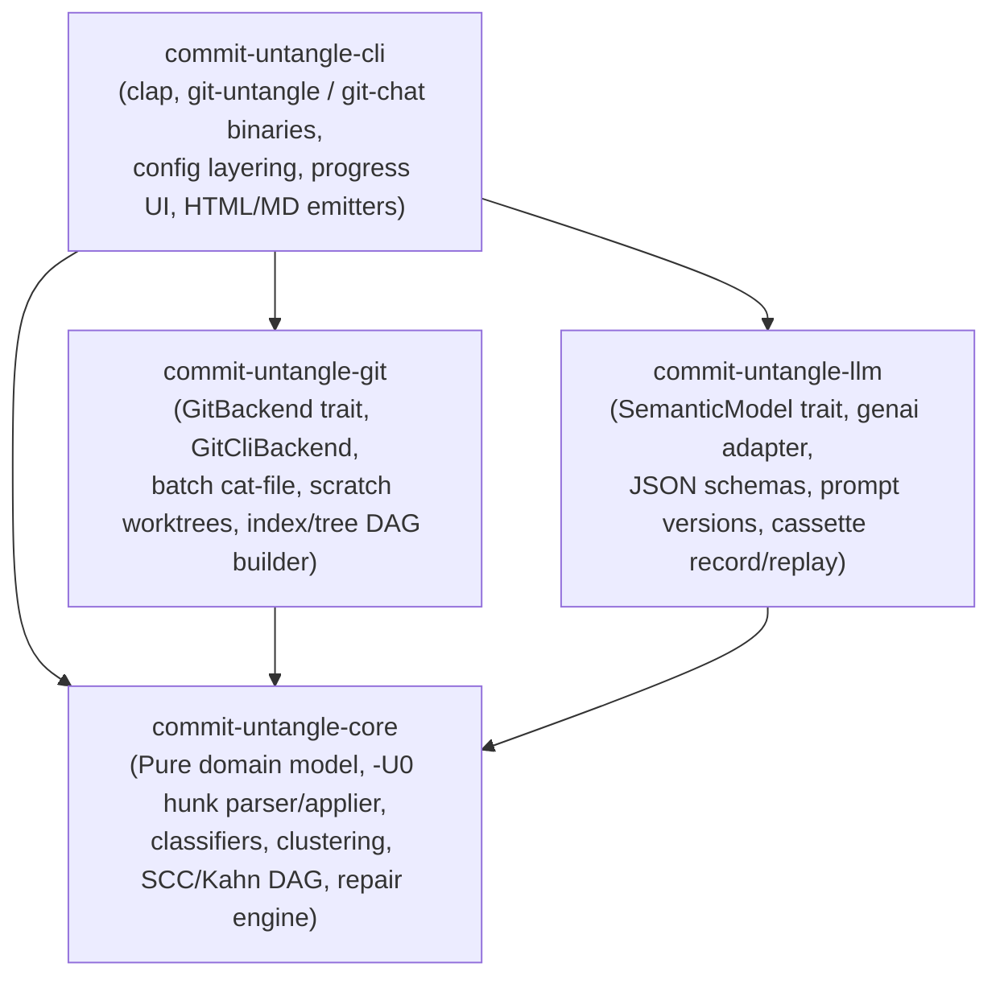
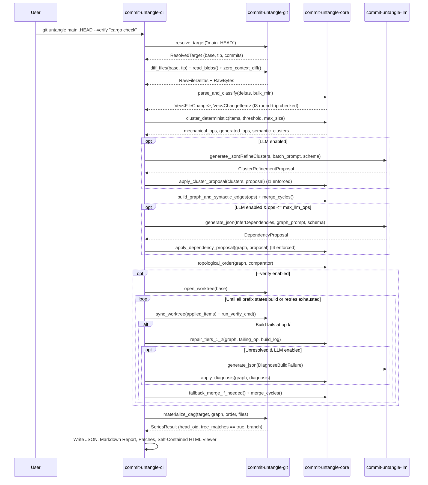

# `git-untangle` Software Architecture & Implementation Plan

## 1. Executive Summary & Architectural Vision

`git-untangle` is a standalone, native Rust CLI and Git subcommand extension that decomposes large commits or commit ranges into an ordered DAG of coherent, atomic operations—optionally refined by an LLM and verified via intermediate builds—while guaranteeing byte-for-byte final tree equivalence.

> **Architectural Slogan:** *Git is the execution substrate, Rust owns the invariants, and the LLM proposes semantic graph edits.*

### 1.1 Key Engineering Decisions

1. **Standalone Rust Binary (`git-untangle` + `git-chat` Dispatch):**
   * Compiled to a single cross-platform native binary with zero JVM/runtime dependencies.
   * When invoked as `git-untangle` (or `git untangle ...` via Git's `PATH` subcommand discovery), runs commit/range decomposition directly.
   * Can also be installed/symlinked as `git-chat` (`git chat <command>`), acting as a **syntax-compatible Git wrapper**: recognized semantic commands (`git chat untangle ...`, and future `explain`, `review`, `commit`) execute locally, while all ordinary Git invocations (`git chat status`, `git chat log`, `git chat diff A..B`) transparently `exec` the system `git` binary with arguments untouched.
2. **Real Git CLI First Behind a `GitBackend` Trait:**
   * Rather than prematurely reimplementing Git's rename heuristics (`-M`), range semantics (`A...B`), worktrees, or binary patch formatting on `libgit2`/`gix`, v1 ships `GitCliBackend` invoking the installed `git` binary as the semantic reference implementation, isolated behind a narrow `GitBackend` trait so `GixBackend` or `LibGit2Backend` can optimize hot paths later if profiling warrants.
3. **Narrow `SemanticModel` Trait Backed by `genai`:**
   * Avoids heavyweight agent frameworks. Uses [`genai`](https://github.com/jeremychone/rust-genai) inside `commit-untangle-llm` for native multi-provider protocol support (Anthropic, Gemini, OpenAI, Ollama, OpenRouter, AWS Bedrock, Google Vertex) without leaking provider types into core logic.
4. **LLM as Proposal Engine (Graph Patching):**
   * Replaces fragile full-plan regeneration with constrained **patch actions** (`merge_clusters`, `split_cluster`, `move_items`, `relabel`) and **cycle-checked edge proposals**. Even malformed or partial LLM output cannot violate partition or DAG invariants.
5. **First-Class Deterministic Mode (`--no-llm`):**
   * Identical CLI flags, JSON schema, Markdown report, HTML viewer, and commit DAG output whether an LLM is enabled or disabled—suitable for CI, offline/air-gapped use, private repositories, and deterministic regression testing.
6. **Honest Byte & Mode Modeling:**
   * Replaces the reference Kotlin implementation's `ISO-8859-1 String` byte-container trick with `BString` / `Vec<u8>` (`bstr` crate) for exact content and explicit `DisplayStr` wrappers for lossy UTF-8 display/tokenization, while tracking Git `FileMode` (`100644`, `100755`, `120000`, `160000`) to close the file-permission gap in `HEAD^{tree} == tip^{tree}`.

---

## 2. Workspace & Crate Architecture

The Cargo workspace is partitioned into four crates with strict acyclic dependency boundaries:



### 2.1 Crate Responsibilities & Constraints

| Crate | Allowed I/O | Key Dependencies | Purpose |
|---|---|---|---|
| `commit-untangle-core` | **None** (pure memory; no subprocesses, no fs, no network, no async) | `bstr`, `serde`, `serde_json`, `sha1`, `regex`, `indexmap`, `thiserror` | Data structures, invariants, hunk parsing/replay, lexical/symbol extraction, deterministic clustering, patch validation, Tarjan SCC, Kahn priority topological sort, repair state machine, JSON model. |
| `commit-untangle-git` | Subprocess & temp worktree fs | `commit-untangle-core`, `tokio` (process) or `std::process`, `tempfile`, `bstr`, `tracing` | `GitBackend` trait, `GitCliBackend`, target/range resolution, `cat-file --batch` blob reader, `-U0` diff runner, index-only fast DAG emitter & worktree `Replayer` for `--verify`. |
| `commit-untangle-llm` | Async HTTP (via `genai`) & optional cassette files | `commit-untangle-core`, `genai`, `tokio`, `serde`, `serde_json`, `schemars`, `tracing` | `SemanticModel` trait, `GenAiBackend`, `MockModel`, `RecordingModel` / `ReplayModel`, prompt templates, token/char batching, schema enforcement & retry/repair loop. |
| `commit-untangle-cli` | Terminal, fs artifacts, `exec` | All workspace crates, `clap`, `indicatif` / `console`, `toml`, `anyhow`, `tracing-subscriber` | `git-untangle` and `git-chat` entrypoints, 5-layer config resolution, orchestrator loop, Markdown/HTML/patch artifact writers, exit code policy. |

---

## 3. Detailed Design by Crate

### 3.1 `commit-untangle-core`

#### 3.1.1 Module Layout
```text
crates/commit-untangle-core/src/
├── lib.rs
├── bytes.rs          # RawBytes (BString), DisplayText (UTF-8), LineSlice
├── model.rs          # ItemId, OpId, ClusterId, FileMode, FileChange, ChangeItem, Operation
├── hunk.rs           # ZeroContextHunk, parse_zero_context_diff(), apply_hunks()
├── classify.rs       # WHITESPACE, REORDER, substitution_of(), BULK_REPLACE, is_generated_path()
├── symbols.rs        # Tokenizer, keyword tables, regex def extractor, item signatures
├── cluster.rs        # Inverted index, Jaccard + def-use + locality weights, UnionFind, splitter
├── proposal.rs       # ClusterPatch, DependencyProposal, DiagnosisProposal + strict validators
├── graph.rs          # ChangeGraph, syntactic edges, Tarjan SCC merge, Kahn priority topo-sort
├── replay.rs         # Pure file_state(file, applied_set), desired_tree_delta()
├── verify.rs         # Pure verification repair state machine (Tiers 1, 2, 4 + Tier 3 hook)
└── schema.rs         # Serializable AnalysisArtifact (v1 JSON contract)
```

#### 3.1.2 Honest Byte & Mode Types (`bytes.rs`, `model.rs`)
```rust
use bstr::BString;

/// Exact repository bytes (blobs, diff lines with terminators, binary patches).
#[derive(Clone, PartialEq, Eq, Hash)]
pub struct RawBytes(pub BString);

/// Explicitly decoded UTF-8 text (lossy only at conversion boundary) for prompts, UI, and regexes.
#[derive(Clone, Debug, PartialEq, Eq, PartialOrd, Ord, Hash, serde::Serialize, serde::Deserialize)]
pub struct DisplayText(pub String);

impl RawBytes {
    pub fn to_display(&self) -> DisplayText {
        DisplayText(String::from_utf8_lossy(&self.0).into_owned())
    }
    pub fn is_binary(&self) -> bool {
        let limit = self.0.len().min(8000);
        self.0[..limit].contains(&0u8)
    }
}

#[derive(Copy, Clone, Debug, PartialEq, Eq, Hash, serde::Serialize, serde::Deserialize)]
pub enum FileMode {
    Regular,      // 100644
    Executable,   // 100755
    Symlink,      // 120000
    Gitlink,      // 160000 (submodule commit OID)
}
```
* **Improvement over Prototype:** Tracking `old_mode` and `new_mode` on `FileChange` (including a `MODE_CHANGE` mechanical item or attaching mode transition to the file's primary/move item) guarantees that `chmod +x`, symlinks, and gitlinks reconstruct the exact Git tree OID in Stage 5.

#### 3.1.3 Constrained LLM Proposal Language (`proposal.rs`)
Instead of asking the LLM to echo back hundreds of item IDs—where omitting or hallucinating a single ID breaks the partition—Stage 2B uses a patch algebra over deterministic clusters `c1..ck`:

```rust
#[derive(Debug, Clone, serde::Deserialize, schemars::JsonSchema)]
#[serde(tag = "type", rename_all = "snake_case")]
pub enum ClusterAction {
    MergeClusters {
        clusters: Vec<String>,
        reason: String,
    },
    SplitCluster {
        cluster: String,
        groups: Vec<Vec<String>>,
        reason: Option<String>,
    },
    MoveItems {
        items: Vec<String>,
        from_cluster: String,
        to_cluster: String,
    },
}

#[derive(Debug, Clone, serde::Deserialize, schemars::JsonSchema)]
pub struct OperationLabel {
    pub name: String,
    pub description: String,
    pub category: String,
    #[serde(default)]
    pub suspicious: bool,
    pub suspicion_reason: Option<String>,
}

#[derive(Debug, Clone, serde::Deserialize, schemars::JsonSchema)]
pub struct ClusterRefinementProposal {
    #[serde(default)]
    pub actions: Vec<ClusterAction>,
    #[serde(default)]
    pub labels: indexmap::IndexMap<String, OperationLabel>,
}
```
**Patch Application Rules (`apply_cluster_proposal`):**
1. Start from the deterministic partition $P = \{c_1, \dots, c_k\}$.
2. Apply each action sequentially **atomically per action**:
   * `MergeClusters`: Verify all referenced cluster IDs currently exist; merge into a deterministic composite ID (e.g., `c3+c7`). If any ID is stale/invalid, skip that single action with a diagnostic warning.
   * `SplitCluster`: Verify `cluster` exists; intersect proposed `groups` with `cluster`'s actual items, deduplicating across groups; if any items in `cluster` were omitted from `groups`, append them to the largest matching sub-group (or a remainder group) so **no item is ever lost**. Assign deterministic IDs `c9.1`, `c9.2`, …
   * `MoveItems`: Move valid items currently belonging to `from_cluster` into `to_cluster`; if `from_cluster` becomes empty, remove it.
3. Apply `labels` to resulting clusters; any unlabeled cluster receives deterministic `default_label(items)`.
4. Assert post-condition **Invariant I1** ($\bigsqcup O_i = \mathcal{I}$) via debug/release check.

---

### 3.2 `commit-untangle-git`

#### 3.2.1 `GitBackend` Trait
```rust
#[async_trait::async_trait]
pub trait GitBackend: Send + Sync {
    async fn repo_info(&self) -> Result<RepoInfo>;
    async fn resolve_target(&self, spec: &TargetSpec) -> Result<ResolvedTarget>;
    async fn diff_files(
        &self,
        base: &Oid,
        tip: &Oid,
        pathspecs: &[RepoPath],
    ) -> Result<Vec<RawFileDelta>>;
    async fn read_blobs(&self, keys: &[(Oid, RepoPath, FileMode)]) -> Result<Vec<RawBytes>>;
    async fn zero_context_diff(
        &self,
        base_blob: &Oid,
        tip_blob: &Oid,
    ) -> Result<RawBytes>;
    async fn open_worktree(&self, base: &Oid) -> Result<Box<dyn WorktreeSession>>;
    async fn materialize_dag(
        &self,
        target: &ResolvedTarget,
        graph: &ChangeGraph,
        order: &[OpId],
        files: &[FileChange],
        options: &EmitOptions,
    ) -> Result<SeriesResult>;
}
```

#### 3.2.2 Performance & Correctness Optimizations in `GitCliBackend`
The Kotlin prototype spawns a separate `git cat-file blob` and `git diff -U0` process *per changed file*, plus a `git checkout` + `git add` + `git commit` per item in a physical worktree even when build verification is disabled. `GitCliBackend` preserves 100% Git CLI semantics while eliminating subprocess bottlenecks:

1. **Pipelined Blob Fetching (`git cat-file --batch`):**
   * `diff --raw -z -M --no-abbrev <base> <tip>` gives exact old/new blob OIDs, modes, statuses, and paths in **one** subprocess.
   * All needed blobs are streamed from a **single** persistent `git cat-file --batch` child process over stdin/stdout pipes.
2. **Dual DAG Materialization Strategies:**
   * **Fast Index-Only Path (when `--verify` is off and `--dry-run` is off):**
     Uses a temporary `GIT_INDEX_FILE` initialized from `base^{tree}` (`git read-tree <base>`), writes modified blobs via a persistent `git hash-object -w --stdin-paths` / `--stdin`, updates index entries via `git update-index -z --index-info` (handling `100644`, `100755`, `120000`, `160000`, and deletions cleanly), writes trees via `git write-tree`, and creates item & merge commits via `git commit-tree`. **Zero working-tree disk checkouts are required**, making 200-item DAG emission 10–30x faster and preserving executable/symlink modes automatically.
   * **Scratch Worktree Path (when `--verify <cmd>` is enabled):**
     Creates an RAII-guarded temporary worktree (`TempWorktree` implementing `Drop` with `git worktree remove --force` + `git worktree prune`) so compilers/test runners have a real filesystem directory (preserving relative subdirectory `prefix` inside monorepos).

---

### 3.3 `commit-untangle-llm`

#### 3.3.1 Narrow `SemanticModel` Boundary
```rust
#[derive(Debug, Clone, Copy, PartialEq, Eq, serde::Serialize, serde::Deserialize)]
pub enum SemanticTask {
    RefineClusters,
    InferDependencies,
    DiagnoseBuildFailure,
}

#[derive(Debug, Clone, serde::Serialize, serde::Deserialize)]
pub struct StructuredRequest {
    pub task: SemanticTask,
    pub prompt_version: &'static str,
    pub system_prompt: String,
    pub user_prompt: String,
    pub json_schema: serde_json::Value,
    pub temperature: f32,
}

#[async_trait::async_trait]
pub trait SemanticModel: Send + Sync {
    async fn generate_json(&self, req: StructuredRequest) -> Result<serde_json::Value>;
}
```

#### 3.3.2 `genai` Integration & Resilience
* **Model Specifiers:** Accepts `genai` provider-qualified model strings directly (e.g., `anthropic::claude-sonnet-4-5`, `gemini::gemini-2.5-pro`, `openai::gpt-4.1`, `ollama::qwen2.5-coder:32b`, `openrouter::...`) as well as custom base URLs.
* **Structured Output Enforcement:** Uses `schemars::schema_for!` on proposal structs (`ClusterRefinementProposal`, `DependencyProposal`, `DiagnosisProposal`), passing native JSON Schema response constraints via `genai::chat::ChatOptions` where supported, with markdown JSON fence extraction and 1-shot schema-error retry repair for local/Ollama models.
* **Cassette Record & Replay (`RecordingModel` / `ReplayModel`):**
  * Keyed by `SHA-256(task || prompt_version || system_prompt || user_prompt || schema)`.
  * `--record-llm <dir>` writes deterministic JSONL cassettes; `--replay-llm <dir>` runs offline golden tests and cross-provider benchmarks without network access.

---

### 3.4 `commit-untangle-cli`

#### 3.4.1 Dual Entrypoint & Wrapper Dispatch (`git-untangle` and `git-chat`)
Inspect `argv[0]` file stem (stripping `.exe` on Windows):
* **`git-untangle` mode:** Parses `UntangleArgs` directly (`git untangle [OPTIONS] [TARGET] [-- <PATHS>...]`).
* **`git-chat` mode:**
  * If `argv[1]` matches a registered semantic subcommand (`untangle`, `version`, `help-chat`), dispatch to the corresponding internal handler.
  * Otherwise, forward all `argv[1..]` directly to the underlying `git` executable (`Command::new("git").args(&argv[1..]).exec()` on Unix / `status()` exit-code passthrough on Windows), preserving stdio, TTY colors, pagers, aliases, and exit codes verbatim.

#### 3.4.2 CLI Surface (`git untangle` / `git chat untangle`)
```text
git untangle [OPTIONS] [REVISION_OR_RANGE] [-- <PATHSPECS>...]

Arguments:
  [REVISION_OR_RANGE]          Commit (default: HEAD) or range (A..B, A...B)
  [PATHSPECS]...               Optional paths restricting analyzed diff

Options:
      --base <REV>             Explicit base revision (equivalent to <REV>..<TARGET>)
      --no-llm                 Pure deterministic mode (no network / model calls)
  -m, --model <PROVIDER::ID>   LLM identifier (e.g. anthropic::claude-sonnet-4-5)
      --verify <CMD>           Shell command run to verify each intermediate operation builds
      --verify-timeout <SECS>  Per-build timeout in seconds [default: 600]
      --max-retries <N>        Maximum verification graph repair iterations [default: 10]
      --emit <TARGETS>         Comma-separated outputs: branch,json,report,patches,viewer [default: branch,json,report,viewer]
  -b, --branch <NAME>          Output branch name [default: untangle/<short-id>]
  -o, --output-dir <DIR>       Directory for JSON/report/patches/viewer [default: .git/untangle/<short-id>]
      --dry-run                Analyze and write report/JSON without creating Git commits or refs
      --mechanical-placement <POS>  Placement of mechanical ops: first | last [default: first]
      --similarity <FLOAT>     Clustering threshold in (0.0, 2.0] [default: 0.5]
      --bulk-min <N>           Min occurrences for bulk-replace detection [default: 3]
      --max-cluster-size <N>   Max items per deterministic cluster [default: 40]
      --max-llm-ops <N>        Max operations for LLM dependency reasoning [default: 200]
      --record-llm <PATH>      Record LLM requests/responses to cassette file
      --replay-llm <PATH>      Replay LLM responses offline from cassette file
      --json                   Print machine-readable summary JSON to stdout
  -q, --quiet                  Suppress progress spinners
  -v, --verbose                Increase diagnostic logging (-v, -vv)
```

#### 3.4.3 5-Layer Configuration Model
Configuration values resolve in strict precedence order (highest to lowest):

1. **CLI flags** (`--model`, `--verify`, `--no-llm`, etc.)
2. **Repository Git config** (`.git/config` `[untangle]` section via `git config --local --get-regexp '^untangle\.'`)
3. **User/Global Git config** (`~/.gitconfig` / `$XDG_CONFIG_HOME/git/config` `[untangle]`)
4. **Tool config file** (`$XDG_CONFIG_HOME/git-untangle/config.toml`)
5. **Compiled defaults**

Supported `git config` keys:
* `untangle.model` (e.g., `gemini::gemini-2.5-pro`)
* `untangle.useLlm` (`true` / `false`)
* `untangle.verifyCommand` (e.g., `cargo check --quiet`)
* `untangle.verifyTimeout` (`600`)
* `untangle.mechanicalPlacement` (`first` / `last`)
* `untangle.similarityThreshold` (`0.5`)
* `untangle.emit` (`branch,json,report,viewer`)
* `untangle.branchPrefix` (`untangle/`)

> **Security Invariant:** API keys and tokens are **never** read from or written to `.git/config` or `config.toml`. Credentials are resolved exclusively by `genai` from standard provider environment variables (`ANTHROPIC_API_KEY`, `GEMINI_API_KEY`, `OPENAI_API_KEY`, etc.) or OS keychain helpers. If keys appear in `untangle.*` Git config, the CLI refuses to use them and emits a security warning.

#### 3.4.4 Exit Code Contract

| Exit Code | Meaning |
|---|---|
| `0` | Success; exact reconstruction (`I3`/`I5`) verified (and build verification passed or skipped). |
| `2` | Invalid CLI usage, bad revision/range syntax, or invalid configuration. |
| `3` | Repository precondition failure (not a Git repo, root commit with no parent, empty range). |
| `4` | Decomposition succeeded and branch/artifacts emitted, but `--verify` exhausted retry budget (partial verification). |
| `5` | Internal invariant violation (`exact_reconstruction == false` or `tree_matches == false`) — treated as a bug/hard failure, refuses to overwrite user branches. |

---

## 4. Orchestration & Data Flow



---

## 5. Testing, Property Verification, & Fuzzing Strategy

### 5.1 Property-Based Tests (`proptest` in `commit-untangle-core`)
1. **Arbitrary Hunk Subset Commutativity & Exactness:**
   Generate random byte buffers (including binary bytes, `\r\n`, `\n`, missing EOF newlines, empty files) and arbitrary edits; run `-U0` diffing and assert that:
   * `apply_hunks(old, &[]) == old`
   * `apply_hunks(old, &all_hunks) == new`
   * For 100 random subsets $S \subseteq \text{all\_hunks}$, `apply_hunks` succeeds without panic or out-of-bounds error and produces identical output regardless of input slice permutation.
2. **Proposal Validator Conservation (Invariant I1):**
   Generate arbitrary initial partitions and adversarial/fuzzed `ClusterRefinementProposal` payloads (duplicate IDs, missing IDs, cyclic moves, nonexistent cluster names, empty splits) and assert `apply_cluster_proposal` never panics and always outputs an exact partition of $\mathcal{I}$.
3. **Graph Contraction & Acyclicity (Invariant I4):**
   Generate random directed multigraphs, run `merge_cycles()`, add random cycle-checked edges (`allow_cycle = false`), and assert `topological_order()` always visits every original `ChangeItem` exactly once without cycle panic.

### 5.2 Fuzz Targets (`cargo-fuzz`)
* `fuzz_parse_hunks`: Feeds arbitrary byte slices into `parse_zero_context_diff` + `apply_hunks`.
* `fuzz_substitution_of`: Feeds arbitrary multi-line hunks with multibyte UTF-8 and non-UTF-8 bytes into `substitution_of` to verify slice indexing never panics on char boundaries.
* `fuzz_proposal_json`: Feeds arbitrary JSON values into proposal deserialization + application.

### 5.3 Git Integration Corpus (`commit-untangle-git/tests/`)
Temporary Git repositories synthesized per test covering:
* Pure renames (`git mv`), rename + edit (`R085`), copy, delete, add, and swap-renames (`a -> tmp`, `b -> a`).
* Executable bit transitions (`100644 -> 100755`), symlinks (`120000`), submodules (`160000`), and binary assets (PNG/Wasm blobs).
* Merge commits (`HEAD^1` vs `HEAD^2`), `A..B` linear ranges, `A...B` symmetric ranges on diverged branches, and non-ancestor `A..B` tree diffs.
* Diamond and octopus dependency graphs verifying transitive reduction, multi-parent merge commits, sink merges, and `HEAD^{tree} == tip^{tree}`.
* Simulated compiler script failing until `op_def` precedes `op_use` (Tier 1), until `op_drop_ref` precedes `op_del_def` (Tier 2), and mutually dependent operations requiring fallback merge (Tier 4).

### 5.4 LLM Cassette & Golden Suite (`commit-untangle-llm/tests/`)
* Checked-in JSONL cassettes recorded from real tangled commits across Anthropic, Gemini, and OpenAI models, replayed deterministically in CI with `--replay-llm`.

---

## 6. Phased Implementation Roadmap

### Milestone 1: Workspace Skeleton & Pure Core Foundation
* **Scope:** Initialize Cargo workspace (`core`, `git`, `llm`, `cli`). Implement `RawBytes`/`DisplayText`, `ZeroContextHunk` parser and applier, `ItemKind` mechanical classifiers (`WHITESPACE`, `REORDER`, `substitution_of`, `BULK_REPLACE`), lexical tokenizer/symbol extractor, and `file_state` pure replay function.
* **Acceptance Criteria:** `proptest` suite (10,000 cases) and `cargo-fuzz` smoke runs pass with zero panics; 100% round-trip byte accuracy on LF, CRLF, missing-EOF-newline, and binary fixtures.

### Milestone 2: Deterministic Clustering, Graph Engine, & JSON Contract
* **Scope:** Implement inverted-index Jaccard + def-use + locality clustering, Union-Find + recursive splitting, deterministic naming/categorization, syntactic dependency inference, Tarjan SCC contraction, priority-queue Kahn topological sort, and `AnalysisArtifact` JSON serializer (compatible with the viewer contract).
* **Acceptance Criteria:** Deterministic end-to-end tests in `core` decompose synthetic multi-file commits into expected operations, contract intentional cycles, and produce stable JSON snapshots.

### Milestone 3: `GitCliBackend` & `--no-llm` End-to-End Product
* **Scope:** Implement `GitCliBackend` (target/range resolution, `diff --raw -z -M`, pipelined `cat-file --batch`, `-U0` diffing, fast temporary-index DAG commit emitter with transitive reduction and multi-parent merges, `^{tree}` equality verifier). Wire `git-untangle` and `git-chat` CLI entrypoints, 5-layer config, Markdown report, patch export, and bundled interactive HTML viewer template.
* **Acceptance Criteria:** `git untangle HEAD --no-llm` and `git chat untangle A...B --no-llm` run against real open-source repositories (including self-hosting on `git-untangle` and historical Cognotik commits), producing branches whose `HEAD^{tree}` matches `tip^{tree}` identically, including file modes and symlinks.

### Milestone 4: `commit-untangle-llm` (`genai`) & Proposal Algebra
* **Scope:** Implement `SemanticModel` trait, `GenAiBackend` adapter, `ClusterRefinementProposal` patch applicator, `DependencyProposal` cycle-checked applicator, batching/budgeting logic, prompt templates (`v1`), and cassette record/replay (`--record-llm` / `--replay-llm`).
* **Acceptance Criteria:** Verified live and recorded runs against Anthropic, Gemini, OpenAI, and local Ollama models; adversarial/truncated responses fall back cleanly without violating Invariants **I1** or **I4**.

### Milestone 5: Scratch Worktree `Replayer` & Closed-Loop Build Verification
* **Scope:** Implement RAII `TempWorktree`, incremental `Replayer` (syncing content + executable/symlink modes), baseline check (`A0`), prefix build runner with timeout, and the 4-tier repair cascade (missing symbol, premature deletion, LLM `DiagnoseBuildFailure`, fallback merge).
* **Acceptance Criteria:** Integration tests with synthetic Rust/shell projects containing broken intermediate states automatically repair the DAG via edge insertion or cycle merging and emit a fully buildable commit series (`verification.status == "passed"`).

### Milestone 6: Packaging, Cross-Platform Distribution, & Optional Host Integration
* **Scope:** Cross-platform CI matrix (Linux `x86_64`/`aarch64` musl/gnu, macOS universal, Windows `x86_64`), shell completions (`clap_complete`), manpage generation (`clap_mangen`), installation docs (`git-untangle` + `git-chat` symlink), and optional JSON-over-CLI adapter allowing external orchestrators (such as Cognotik) to invoke `git-untangle --json` as a native engine.
* **Acceptance Criteria:** Static/self-contained release binaries pass the full integration and cassette test suites on Linux, macOS, and Windows.
